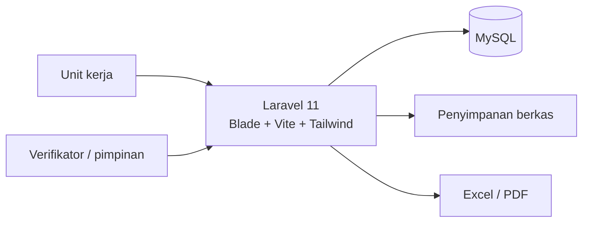

# SAKIP RSUD M. Natsir — Sistem Akuntabilitas Kinerja Instansi Pemerintah

> Sistem untuk menyusun, mengumpulkan, dan melaporkan dokumen akuntabilitas kinerja (SAKIP) RSUD Mohammad Natsir Solok: dokumen per jenis dan unit kerja, bukti dukung, alur verifikasi, serta ekspor laporan.

| | |
|---|---|
| Instansi | RSUD Mohammad Natsir Solok |
| Peran saya | Pengembangan aplikasi dan dukungan operasional |
| Status | Dipakai internal |

## Fitur utama

- **Dokumen kinerja per unit kerja**: jenis dokumen dipetakan ke unit kerja yang wajib mengumpulkan.
- **Alur kerja dokumen**: unggah, verifikasi, revisi, dan persetujuan.
- **Bukti dukung (dakung)** per kegiatan dan indikator.
- **Data pegawai** terkait unit kerja, termasuk STR/SIP tenaga kesehatan.
- **Notifikasi** perubahan status dokumen.
- **Import dan ekspor** Excel serta PDF.
- Peran dan izin, log aktivitas lengkap.

## Arsitektur

## Model data (ringkas)

`employees` · `unit_kerja` · `jenis_dokumen` · `jenis_dokumen_unit_kerja` · `documents` (dengan status workflow) · `dakung` · `files` · `notifications` · `activity_log`

## Tech stack

| Lapis | Teknologi |
|---|---|
| Aplikasi | Laravel 11 (PHP 8.2), Blade, Vite |
| UI | Tailwind CSS, Sass |
| Auth | Laravel Sanctum, spatie/permission |
| Laporan | DomPDF, Laravel Excel |
| Data | MySQL |
| Deploy | Docker Compose |

---

> **Catatan kerahasiaan.** Kode sumber aplikasi ini private karena milik/dipakai instansi. Repo ini hanya menjelaskan konteks, fitur, arsitektur, dan peran saya. Tidak ada kode, data pegawai, data pasien, alamat server, maupun kredensial di sini.

**Maizan Insani Akbar** · Software Engineer & System Analyst · [Portfolio](https://izanmaizan.vercel.app) · [LinkedIn](https://www.linkedin.com/in/izanmaizan/) · [GitHub](https://github.com/izanmaizan)
